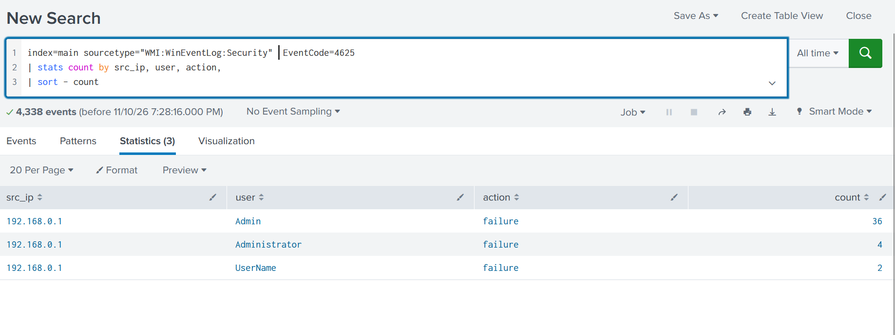
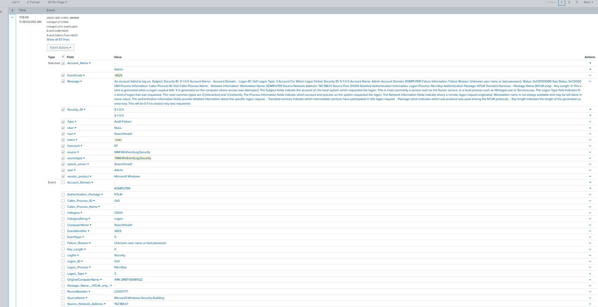
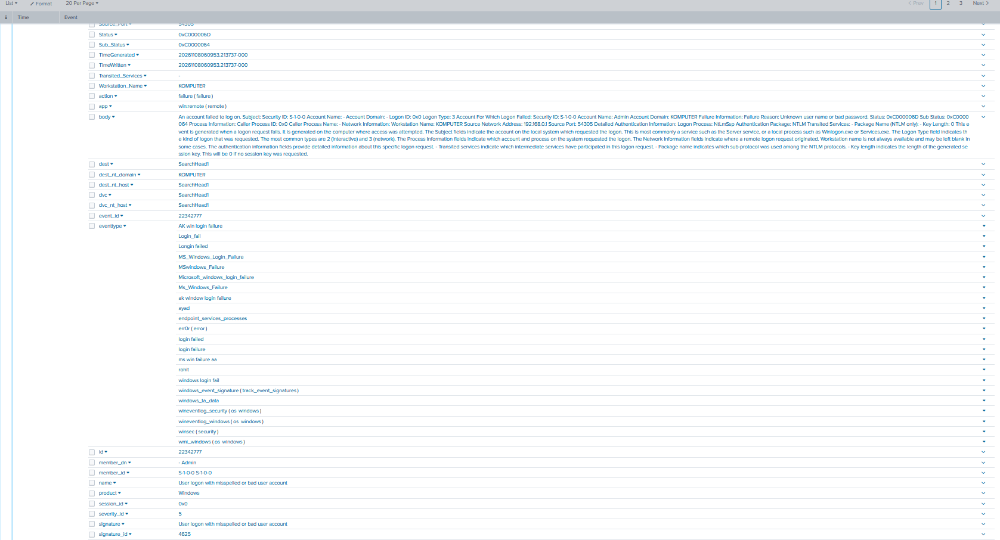

# Login Failed to Windows Devices with Event Code 4625

## Project overview

This project demonstrates how to investigate failed Windows logon attempts in Splunk using **Windows Security Event ID 4625**. It uses Windows Security Event Log data collected through the Splunk Windows Management Instrumentation (WMI) input.

A failed logon event is generated when a logon request is unsuccessful. Reviewing these events helps a SOC analyst identify repeated authentication failures, mistyped credentials, attempts using invalid accounts, and potentially suspicious login activity.

## Lab environment

- **SIEM:** Splunk Enterprise
- **Log source:** Windows Security Event Log
- **Collection method shown:** WMI
- **Index:** `main`
- **Sourcetype:** `WMI:WinEventLog:Security`
- **Event ID:** `4625` — An account failed to log on

> Field extractions and field names can differ depending on the Splunk add-on, input configuration, and normalization. Confirm the actual field names in your own events before reusing the searches.

## Investigation objective

1. Find Windows failed logon events (EventCode 4625).
2. Identify the source IP address and targeted username.
3. Count failures by source IP, username, and action.
4. Review the raw event to understand why authentication failed.
5. Decide whether the activity is expected or requires escalation.

## Splunk searches

### 1. Find failed logon events

```spl
index=main sourcetype="WMI:WinEventLog:Security" EventCode=4625
```

### 2. Count failures by source IP, user, and action

```spl
index=main sourcetype="WMI:WinEventLog:Security" EventCode=4625
| stats count by src_ip user action
| sort - count
```

### 3. Alternative using the Windows event's original source address field

If `src_ip` is not extracted in your environment, try the field shown in the raw event (`Source_Network_Address`):

```spl
index=main sourcetype="WMI:WinEventLog:Security" EventCode=4625
| stats count by Source_Network_Address Account_Name action
| sort - count
```

If your event uses a different username field, inspect the raw event and replace `Account_Name` with the correct field (for example, `user`).

### 4. Review the failure reason and status codes

```spl
index=main sourcetype="WMI:WinEventLog:Security" EventCode=4625
| table _time host Account_Name TargetUserName Source_Network_Address Logon_Type Failure_Reason Status Sub_Status
| sort - _time
```

Not every field in this table will necessarily be extracted in every environment. Remove or replace fields that do not exist in your events.

## Understanding Event ID 4625

**Event ID 4625** means that Windows recorded an unsuccessful logon attempt. It is generated when an account fails to authenticate to a Windows device.

Important fields commonly found in this event include:

| Field | Meaning |
|---|---|
| `EventCode` / `EventID` | Windows event identifier. `4625` indicates a failed logon. |
| `Account_Name` / `TargetUserName` | Account name supplied in the logon attempt. |
| `Source_Network_Address` | Network address from which the logon request originated, when available. |
| `Logon_Type` | Type of logon that was attempted. |
| `Failure_Reason` | Human-readable reason for the failed authentication. |
| `Status` | Main Windows status code describing the failure. |
| `Sub_Status` | More specific reason for the failure. |
| `host` | Host that sent or is associated with the event; validate its meaning in your collection setup. |

### Status codes visible in this lab

The event details in the screenshots show:

- **Status `0xC000006D`:** The logon attempt failed because of invalid logon information.
- **Sub-status `0xC0000064`:** The specified user account does not exist (unknown username).

Windows Event ID 4625 can also occur because of an incorrect password, expired credentials, account restrictions, or other authentication issues. Always interpret the status and sub-status together with the surrounding event details.

## Findings from the screenshots

The Splunk statistics view shows failed logon events associated with source IP `192.168.0.1`:

| Source IP | Username | Action | Count |
|---|---|---|---:|
| `192.168.0.1` | `Admin` | `failure` | 36 |
| `192.168.0.1` | `Administrator` | `failure` | 4 |
| `192.168.0.1` | `UserName` | `failure` | 2 |

The displayed aggregation therefore contains **42 failures** across these three username values.

The detailed event view also shows the failure reason as **“Unknown user name or bad password”** and includes status `0xC000006D` with sub-status `0xC0000064`.

### SOC analyst interpretation

- Multiple failures against account names such as `Admin` and `Administrator` may indicate mistyped credentials, a misconfigured application/service, or username guessing.
- The `192.168.0.1` address is the source address recorded in these events. Do not automatically label it as the attacker's public IP: it may be a local device, router, proxy, or NAT address depending on the network design.
- Validate the source device, destination Windows host, logon type, timestamps, and whether the attempts are expected.
- Look for a successful logon (Event ID `4624`) from the same source or involving the same account after repeated failures.
- Escalate according to the organization's incident response procedure if the activity is unusual or sustained.

## Recommended next steps

1. Confirm which device owns `192.168.0.1`.
2. Review the full raw 4625 events and confirm the username and logon type.
3. Correlate failures with successful logons (Event ID 4624).
4. Check whether the attempts are repeated across multiple accounts or hosts.
5. Document the evidence and follow the organization's SOP before taking containment actions.

## Screenshots

### 1. Splunk failed logon summary



### 2. Windows Event ID 4625 details



### 3. Extracted and normalized event fields



## Disclaimer

This is a learning lab based on the events visible in the supplied screenshots. The findings are not, by themselves, proof of a brute-force attack or compromise. Validate the environment and surrounding telemetry before drawing conclusions or taking action.
