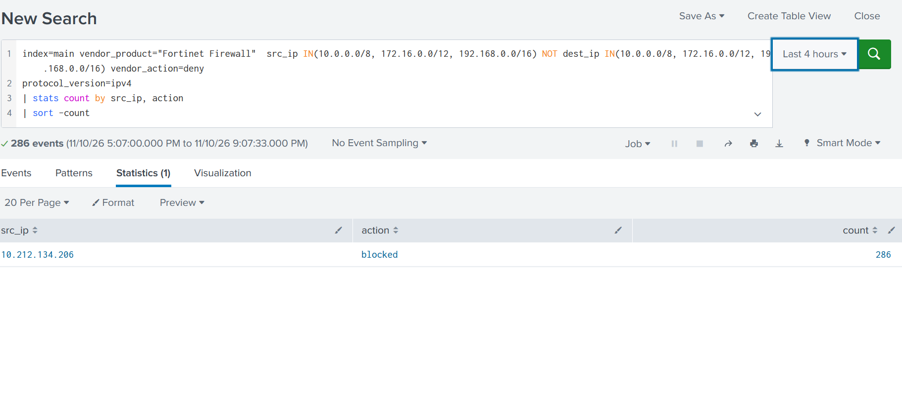
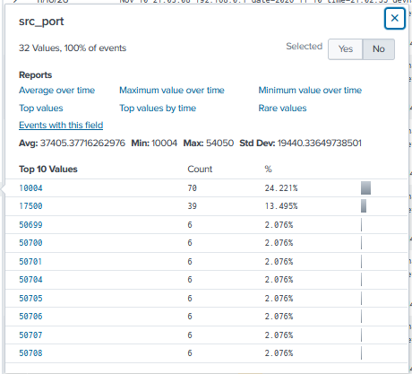
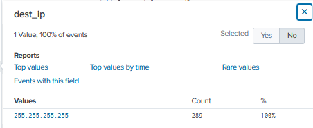
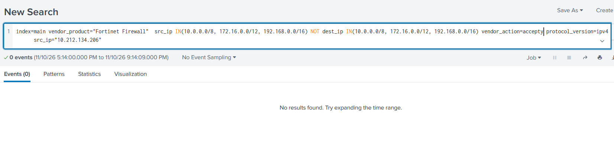

# Investigate Outbound Deny and Accept Traffic (Potentially Compromised Device)

## Project overview
This project demonstrates a SOC investigation of a potentially suspicious internal endpoint using Fortinet Firewall logs in Splunk.

The investigation starts with outbound traffic denied by the firewall. The source IP **`10.212.134.206`** appears in the supplied results with **286 blocked events** in the selected four-hour window. The analyst then checks whether the same source IP also has accepted traffic.

The goal is to distinguish blocked attempts from allowed connections and decide what additional investigation is required.

> A high number of denied events does not, by itself, prove compromise. Zero accepted events in one search window does not prove that the device never communicated successfully.

## Lab environment
- SIEM: Splunk Enterprise
- Log source: Fortinet Firewall
- Index: `main`
- Vendor/product: `vendor_product="Fortinet Firewall"`
- Protocol: IPv4
- Time range shown: Last 4 hours
- Source under investigation: `10.212.134.206`

Field names and action values depend on the Fortinet-to-Splunk field extraction and normalization. Confirm them against raw events.

## Investigation workflow
1. Find internal/private source IPs communicating to destinations outside private ranges.
2. Filter for denied IPv4 traffic.
3. Identify the source IP with the highest count.
4. Review source ports and destination IPs for context.
5. Search for accepted traffic from the same source IP.
6. Compare the results and document limitations.

## Step 1 — Find outbound denied traffic

```spl
index=main vendor_product="Fortinet Firewall"
src_ip IN (10.0.0.0/8, 172.16.0.0/12, 192.168.0.0/16)
NOT dest_ip IN (10.0.0.0/8, 172.16.0.0/12, 192.168.0.0/16)
vendor_action=deny protocol_version=ipv4
| stats count by src_ip, action
| sort - count
```

### Search explanation
- `index=main`: searches the main index.
- `vendor_product="Fortinet Firewall"`: selects Fortinet firewall events.
- `src_ip IN (...)`: selects RFC 1918 private source ranges.
- `NOT dest_ip IN (...)`: excludes RFC 1918 private destinations to focus on traffic that appears outbound.
- `vendor_action=deny`: selects traffic denied by the firewall.
- `protocol_version=ipv4`: limits the search to IPv4.
- `stats count by src_ip, action`: counts events per source and action.
- `sort - count`: sorts highest counts first.

## Step 2 — Identify the source

The supplied summary screenshot shows:

| Source IP | Action | Events |
|---|---|---:|
| `10.212.134.206` | `blocked` | 286 |

The search filters `vendor_action=deny`, while the displayed normalized `action` field is `blocked`. These may be two representations of the same outcome.

`10.212.134.206` is an RFC 1918 private address. It identifies an internal network address, not a globally routable public IP. Use DHCP records, asset inventory/CMDB, endpoint management, or network records to identify the actual device and owner.

## Step 3 — Inspect source ports and destination IP

The supplied source-port panel shows 32 distinct values, with an average of approximately `37405`, a minimum of `10004`, and a maximum of `54050`. A source port is the client-side port; it is not the destination service port.

The destination-IP panel shows `255.255.255.255`.

### Important destination observation
`255.255.255.255` is the IPv4 limited broadcast address, not an ordinary public Internet unicast destination. Validate the raw Fortinet event and field extraction to confirm that `dest_ip` really represents the destination address. Investigate why this endpoint generated broadcast traffic and whether it is expected in this network.

The private-range exclusion does not guarantee that every remaining address is a public unicast Internet destination.

## Step 4 — Check accepted traffic from the same source

Run the corresponding search with the action changed to `accept`, and add the exact source IP:

```spl
index=main vendor_product="Fortinet Firewall"
src_ip IN (10.0.0.0/8, 172.16.0.0/12, 192.168.0.0/16)
NOT dest_ip IN (10.0.0.0/8, 172.16.0.0/12, 192.168.0.0/16)
vendor_action=accept protocol_version=ipv4
src_ip="10.212.134.206"
```

### Result in the supplied screenshot
The search returned **0 events** for the selected time range (Last 4 hours).

This means no events matching all those filters were found for accepted outbound traffic from `10.212.134.206` during that window. It does not prove that the device has never had accepted traffic.

To broaden the check:
- Expand the time range (for example, 24 hours or 7 days).
- Search for the source IP without the outbound destination exclusion.
- Confirm the actual accepted-action value in raw events (`accept`, `allowed`, or another normalized value).
- Verify field names and values in the Fortinet logs.

## Step 5 — Useful follow-up searches

### Compare actions and destinations for this source
```spl
index=main vendor_product="Fortinet Firewall" src_ip="10.212.134.206" protocol_version=ipv4
| stats count by vendor_action, action, dest_ip
| sort - count
```

### Review destination IPs and ports for denied traffic
```spl
index=main vendor_product="Fortinet Firewall"
src_ip="10.212.134.206" vendor_action=deny protocol_version=ipv4
| stats count by dest_ip dest_port src_port
| sort - count
```

### Review activity over time
```spl
index=main vendor_product="Fortinet Firewall"
src_ip="10.212.134.206" protocol_version=ipv4
| timechart span=5m count by vendor_action
```

If a field is not extracted or uses a different name/value in your environment, inspect the raw event and adjust the SPL.

## SOC analyst assessment

Based on the supplied evidence:
1. The outbound-deny search returned 286 blocked events from `10.212.134.206` in the selected four-hour window.
2. The accepted-traffic search for the same source returned zero matching events in that window.
3. The destination field panel showed `255.255.255.255`, which requires validation because it is a limited broadcast address.
4. These observations are not enough to confirm compromise. Possible explanations include misconfiguration, application retries, expected broadcast behavior, scanning, or malicious activity.

### Recommended investigation actions
1. Identify the endpoint assigned `10.212.134.206` using DHCP, CMDB/asset inventory, or endpoint management.
2. Validate raw firewall events, including destination IP/port, action, policy ID, interface, and session details.
3. Expand the time range and search for both accepted and denied sessions.
4. Confirm whether `255.255.255.255` is truly the destination and whether the traffic is expected.
5. Correlate timestamps with endpoint/EDR, DNS, and Windows/Linux telemetry.
6. Check whether other devices show the same pattern.
7. Follow the organization's SOP and escalation process. Do not isolate or block the endpoint solely on this query without validating the evidence and obtaining required authorization.

## Screenshots

### 1. Outbound denied traffic summary


### 2. Source port analysis


### 3. Destination IP analysis


### 4. Accepted traffic check for 10.212.134.206


## Disclaimer
This is a learning project based on the supplied Splunk screenshots. Counts and zero-result observations apply only to the displayed search conditions and time range. They are not proof of compromise or proof that accepted traffic does not exist outside the search scope.
