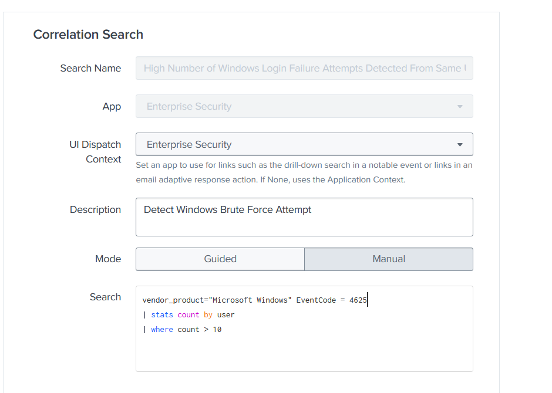
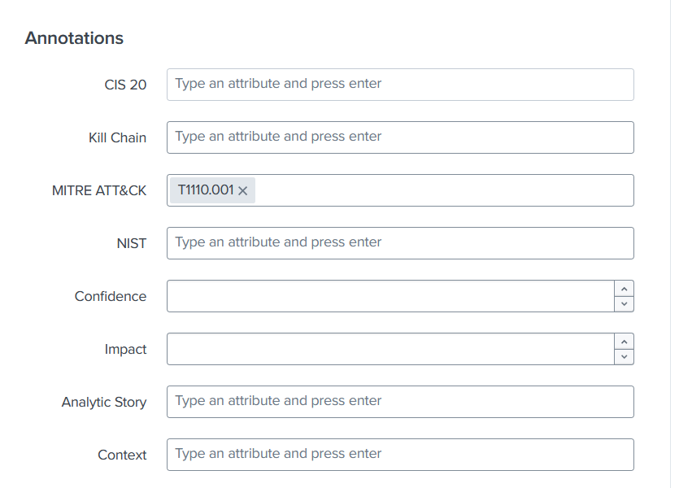
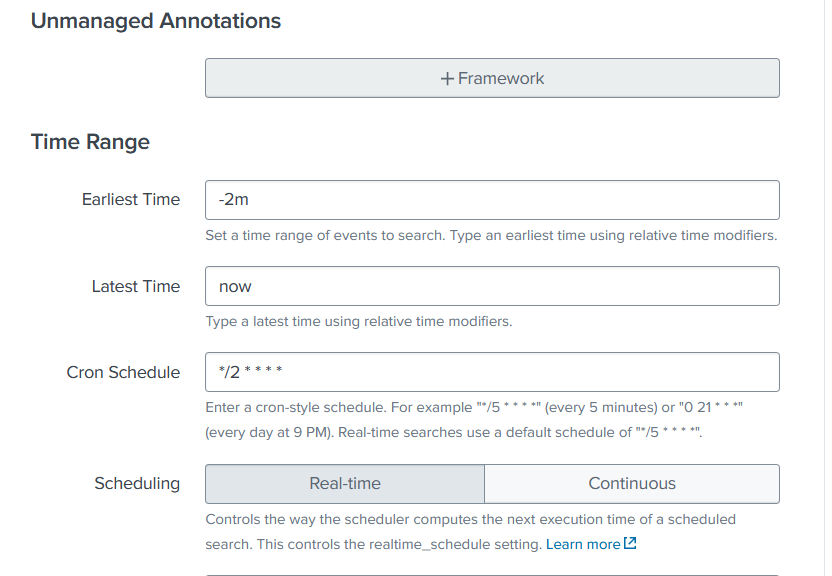
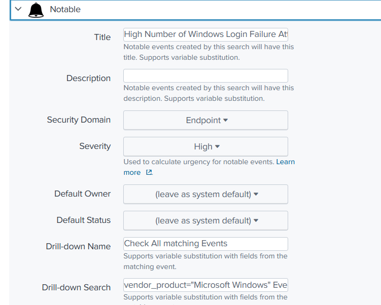
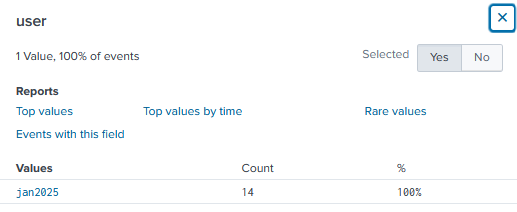
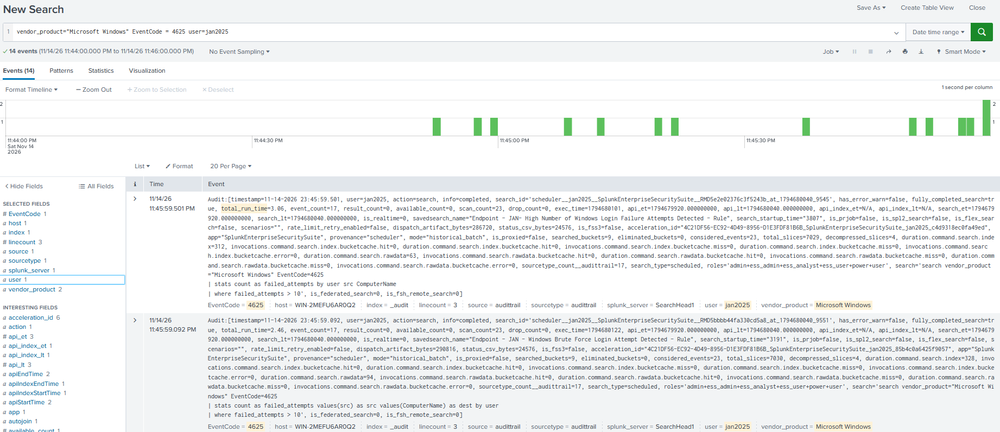
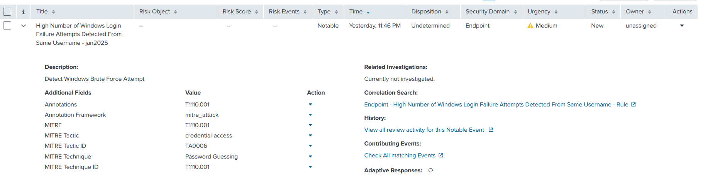

# Windows Brute-Force Detection — Splunk Correlation Search

## Overview

Created a Splunk Enterprise Security correlation search to detect a high number of failed Windows logon attempts (**Event ID 4625**) from the same username. When a username has more than 10 failures in the search window, the rule matches and can create a notable event for SOC investigation.

## 1. Create the correlation search

**Search name:** High Number of Windows Login Failure Attempts Detected From Same Username  
**Description:** Detect Windows Brute Force Attempt  
**App:** Enterprise Security

**SPL:**

```spl
vendor_product="Microsoft Windows" EventCode=4625
| stats count by user
| where count > 10
```



This search filters Windows Event ID 4625, counts failures by username, and returns usernames with more than 10 failures.

## 2. Add detection annotations

**MITRE ATT&CK:** `T1110.001` — Password Guessing



The MITRE mapping describes the behavior the rule is intended to detect. A match is a detection signal, not proof that an attack succeeded.

## 3. Configure the time range and schedule

| Setting | Value |
|---|---|
| Earliest time | `-2m` |
| Latest time | `now` |
| Cron schedule | `*/2 * * * *` |
| Scheduling | Real-time |



The search examines the previous two minutes and is scheduled to run every two minutes, as shown in the lab configuration.

## 4. Configure the notable event

| Setting | Value |
|---|---|
| Security domain | Endpoint |
| Severity | High |
| Drill-down name | Check All matching Events |



When the correlation search matches, Enterprise Security can create a notable event with the configured title, description, domain, and severity.

## 5. Validate the detection

The username field review shows `jan2025` with 14 events in the displayed sample.



A follow-up search for that username returned 14 events:

```spl
vendor_product="Microsoft Windows" EventCode=4625 user=jan2025
```



The audit screenshot also shows the scheduled correlation searches being executed. Since 14 is greater than the configured threshold of 10, this sample meets the rule's detection condition.


## 6. Review the generated notable event

After the correlation search matched the username `jan2025`, Splunk Enterprise Security generated a notable event.

| Notable event field | Value |
|---|---|
| Title | High Number of Windows Login Failure Attempts Detected From Same Username - jan2025 |
| Description | Detect Windows Brute Force Attempt |
| Security domain | Endpoint |
| Severity | **High** |
| Urgency | **Medium** |
| Status | New |
| Disposition | Undetermined |
| Owner | Unassigned |
| MITRE tactic | Credential Access (`TA0006`) |
| MITRE technique | Password Guessing (`T1110.001`) |



The notable event links back to the correlation search and provides a **Check All matching Events** drill-down to review the contributing failed-login events. In this example, the alert is new and has not yet been investigated.

**Severity and urgency are separate fields:** this notable is configured with High severity and shows Medium urgency in the notable-event view. Review both values as part of triage.

## SOC investigation

When an alert is generated:

1. Identify the username with repeated failed logons.
2. Review the matching 4625 events, timestamps, source IPs, and affected hosts.
3. Check logon type and failure status/reason where available.
4. Look for successful logons (Event ID 4624) around the same period.
5. Determine whether the activity is expected or suspicious, then follow the organization's SOP.

## Files

- `windows-login-failure-correlation.spl` — SPL used by the correlation search.
- `screenshots/` — screenshots embedded above in the relevant configuration and validation steps.

## Note

This is a learning-lab detection. More than 10 failed logons from one username may indicate password guessing, but can also result from a user repeatedly entering an incorrect password or a misconfigured service. Tune the threshold to the environment and investigate the surrounding events before concluding that a brute-force attack occurred.
