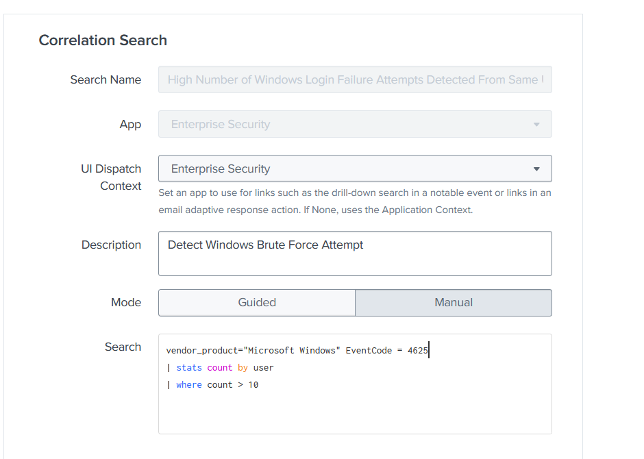
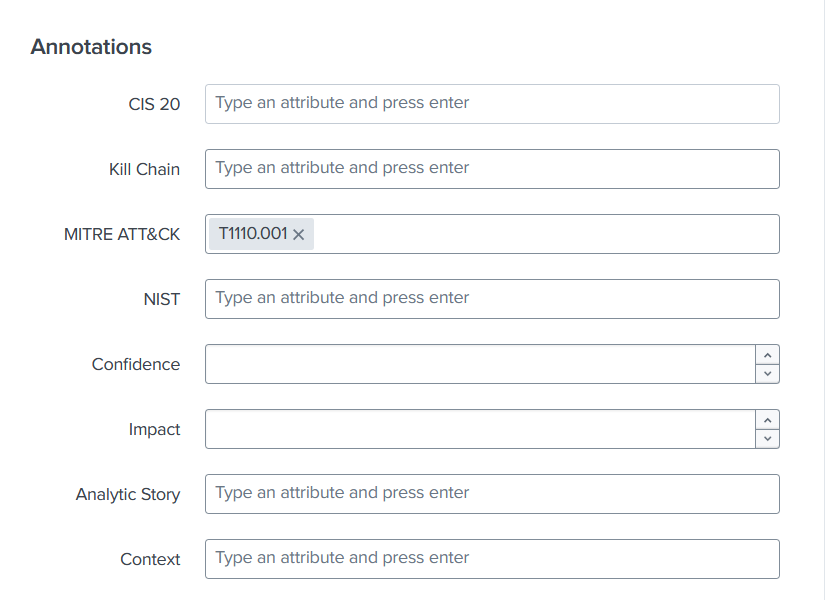
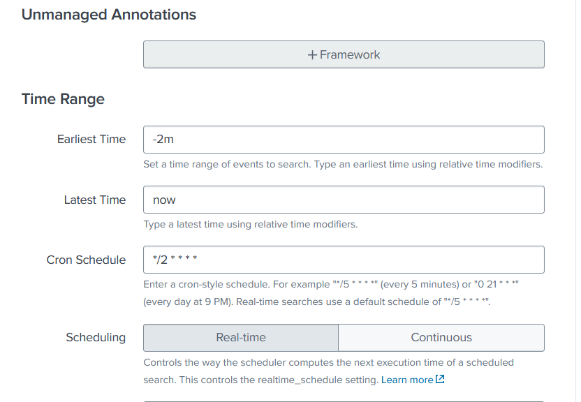
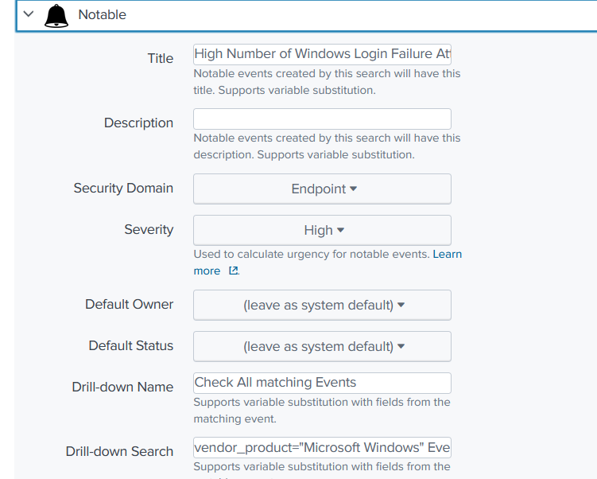
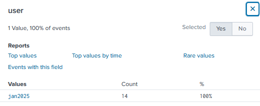
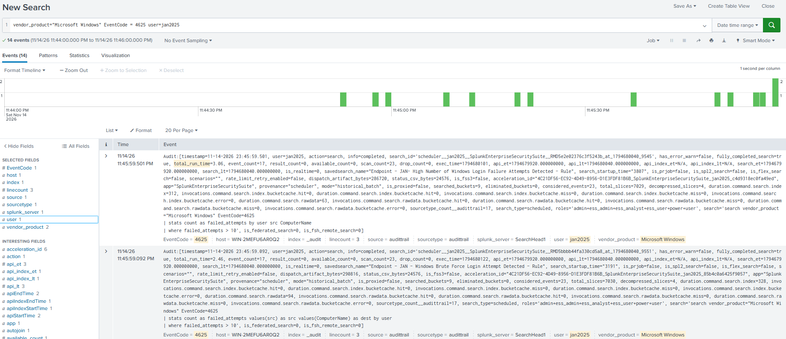

# High Number of Windows Login Failure Attempts Detected From Same Username

## Overview

This home-lab project demonstrates how to create a Splunk Enterprise Security correlation search to detect a high number of failed Windows logon attempts associated with the same username.

The detection uses Windows Security Event ID **4625** (failed logon). Splunk groups matching events by username, counts the failures, and returns usernames with more than **10** failures in the configured search window. The correlation search is configured to generate a **High** severity Endpoint notable event.

The screenshots document the correlation-search configuration, MITRE ATT&CK annotation, schedule, notable settings, username field inspection, and search/audit evidence.

## Detection logic

**Search name:** `High Number of Windows Login Failure Attempts Detected From Same Username`  
**Description:** `Detect Windows Brute Force Attempt`  
**App:** `Enterprise Security`  
**Mode:** `Manual`

### SPL used in the correlation search

```spl
vendor_product="Microsoft Windows" EventCode=4625
| stats count by user
| where count > 10
```

### How it works

1. `vendor_product="Microsoft Windows"` filters for Windows events.
2. `EventCode=4625` selects failed Windows logon events.
3. `stats count by user` groups the events by username and counts the failures for each user.
4. `where count > 10` keeps only usernames with more than 10 failed logon events in the search window.

The threshold is **greater than 10**, not greater than or equal to 10.

## Time range and scheduling

The supplied configuration shows:

- **Earliest time:** `-2m`
- **Latest time:** `now`
- **Cron schedule:** `*/2 * * * *` (every two minutes)
- **Scheduling mode selected:** Real-time

This means the search evaluates a rolling two-minute time window and is scheduled at two-minute intervals. The screenshots show this configuration; verify the scheduler behavior and avoid overlapping or excessive searches in a production deployment.

## Notable event configuration

The screenshots show the following notable settings:

| Setting | Configured value |
|---|---|
| Security Domain | Endpoint |
| Severity | High |
| Drill-down name | Check All matching Events |
| Default owner/status | System default |

The correlation search is configured to create a notable event when the search returns a result. The notable title uses the high-number-of-Windows-login-failures detection name.

## Security annotations

The screenshots show this MITRE ATT&CK technique annotation:

- **MITRE ATT&CK:** `T1110.001` — Password Guessing

This technique is relevant because repeated failed authentication attempts against one username may be consistent with password guessing. However, Event ID 4625 alone does not prove malicious activity. Users mistyping passwords, stale saved credentials, services, and scheduled tasks can also produce repeated failures.

The CIS 20, Kill Chain, and NIST annotation fields are blank in the supplied configuration. No values are inferred for those fields.

## Evidence from the lab

The screenshots show a username field analysis with:

| Username | Failed events shown |
|---|---:|
| `jan2025` | 14 |

The search-results screenshot also shows **14 events** for the search:

```spl
vendor_product="Microsoft Windows" EventCode=4625 user=jan2025
```

This supports the configured threshold: 14 is greater than 10, so this username meets the detection condition for the displayed evidence.

The final screenshot contains Splunk audit events showing scheduled correlation-search executions. The audit records include search definitions that group failed attempts by user and, in one search, collect source and computer-name values for additional context. These are audit records of search execution, not the original Windows 4625 authentication events themselves.

## Additional investigation query

After a username is detected, use a drill-down search to review matching events and investigate source and destination context. The following query reflects the expanded search pattern visible in the audit evidence:

```spl
vendor_product="Microsoft Windows" EventCode=4625
| stats count as failed_attempts values(src) as src values(ComputerName) as dest by user
| where failed_attempts > 10
```

Field availability depends on the Windows event input and field extractions in your Splunk environment. If `src` or `ComputerName` is not populated, inspect the raw Event ID 4625 events and use the field names that are actually present.

To inspect the raw events for the username shown in this lab:

```spl
vendor_product="Microsoft Windows" EventCode=4625 user="jan2025"
```

## SOC analyst investigation steps

When the correlation search identifies a username:

1. Open the notable event and review the contributing events.
2. Identify the username, source address, destination computer, timestamps, and logon type.
3. Check whether failures originate from one source or multiple sources.
4. Review Windows status and sub-status codes to understand why authentication failed.
5. Search for successful logons (Event ID `4624`) involving the same account and source after the failures.
6. Determine whether the activity is expected, such as a user mistyping a password or a service using an outdated credential.
7. If suspicious, follow the organization's SOP and escalation process. Do not assume compromise or disable an account solely from this alert without validation and authorization.

## Screenshots

### 1. Correlation search and SPL configuration


### 2. Security framework annotations


### 3. Time range and schedule


### 4. Notable event configuration


### 5. Username field analysis


### 6. Search execution and audit evidence


## Disclaimer

This is a learning lab based on the supplied Splunk screenshots. The username `jan2025`, count of 14, threshold greater than 10, and configuration values are taken from that evidence. A high count of failed logons is a detection signal that requires investigation; it is not, by itself, confirmation of a brute-force attack or account compromise.
